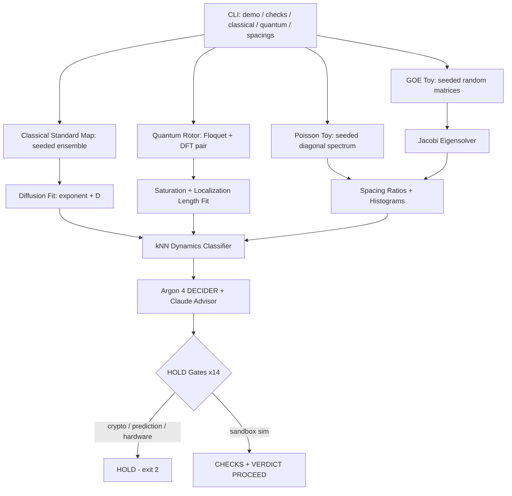
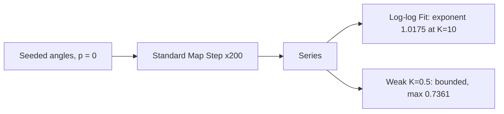
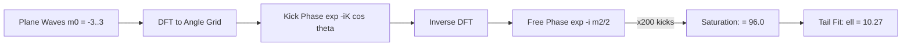
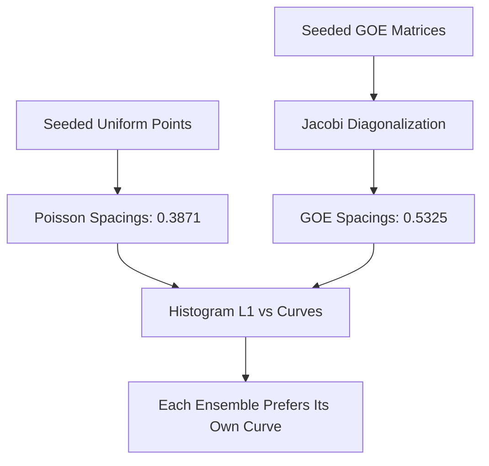
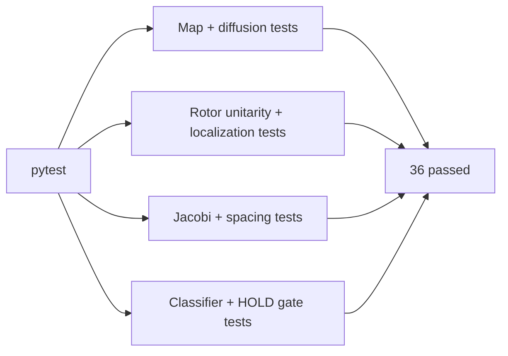
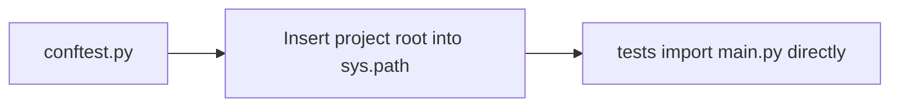
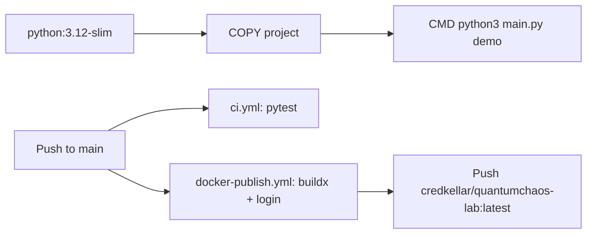

# QuantumChaos-Lab 🌀⚛️

**Kicked Rotor & Level Statistics Lab** — by Darion Kellar

QuantumChaos-Lab is an **educational quantum chaos lab** in ONE pure-Python file. It stages the two classic confrontations between classical chaos and quantum mechanics — with real formulas and measured numbers, not slogans:

- **The kicked rotor (standard map)** — classically, a kicked particle diffuses: at strong kicking its ⟨p²⟩ grows linearly forever (**6,349.7 after 200 kicks** at K = 10, fitted exponent **1.0175**). Quantum-mechanically the same rotor, evolved exactly as a Floquet operator on a 64-state momentum basis, **refuses to diffuse**: at K = 5 its ⟨p²⟩ saturates at **96.0** while the classical rotor at the same K reaches **2,498.3** — a saturation ratio of **0.0384**. That is **dynamical localization**, measured here end to end.
- **Level statistics** — an integrable toy (diagonal spectrum) clusters its levels: ⟨r⟩ = **0.3871** against the Poisson class value 0.38629. A chaotic toy (seeded GOE random matrices, diagonalized by a from-scratch Jacobi solver) repels its levels: ⟨r⟩ = **0.5325** against the GOE class value 0.5359. Both histograms are graded against the Poisson and Wigner curves by L1 distance — and each ensemble prefers its own curve by a wide margin.

Honest scope, stated up front: everything is a **finite, seeded toy**. The rotor lives on 64 momentum states; the random matrices come from a seeded generator, **not** from any measured nucleus, atom, or device. No output predicts a real chaotic system, secures a random number, or encrypts anything. Every such use sits behind a permanent HOLD gate (14 total). 🔒

[](https://github.com/kimanicollier44-cmyk/QuantumChaos-Lab/actions/workflows/ci.yml)
[](https://github.com/kimanicollier44-cmyk/QuantumChaos-Lab/actions/workflows/docker-publish.yml)

> ℹ️ These are the **live** workflow badges for this repo. They activate as soon as the `ci.yml` and `docker-publish.yml` files from the paste pack are pasted into `.github/workflows/` — until then they have nothing to report yet.

## 🧰 Tech Stack Badges & Full Architecture Tech Stack

### 💻 Core Programming Languages & Core Systems


- 🐍 Python 3.12, pure standard library (`math`, `cmath`-free complex arithmetic via built-in `complex`, `random`, `hashlib`, `json`, `sys`) — zero dependencies, zero network, deterministic (double-run byte-identical)
- 🗺️ Classical core: the standard map `p' = p + K·sin θ`, `θ' = θ + p'` iterated over a seeded 2,000-trajectory ensemble; diffusion exponent fitted by least squares in log–log space
- 🌊 Quantum core: the Floquet operator `exp(−i p²/2ħ)·exp(−iK cos θ/ħ)` applied through an explicit unitary DFT pair written from scratch — no FFT library, and the checks prove the roundtrip is the identity to < 1e-9
- 🔢 A from-scratch cyclic Jacobi eigensolver grades the GOE spectra (trace and Frobenius invariants asserted before any spacing is trusted)
- 🧠 TinyML kNN dynamics classifier (from scratch, stdlib): regular / chaotic-diffusive / localized from (diffusion exponent, ⟨r⟩, saturation ratio), labels generated by the lab's own dynamics model
- 🪑 Council seats: Gemini Argon 4 DECIDER (names-only, tighten-only) + Muse advisor (never overrides HOLD) + Google Flow plan-only (rendered = False, live = 0)

### ⛓️ Web3 & Infrastructure

- 🚫 **Not applicable — honestly.** No blockchain, no Web3, no tokens: nothing here is networked, distributed, or on-chain. The only "infrastructure" is one offline file and the Docker image it ships in. No fake badges here.

### ⚙️ Platform Support & Hardware Architecture


- 🖥️ Pure Python — runs anywhere Python 3.12+ runs (Linux, macOS, Windows), plus the `python:3.12-slim` Docker image
- 🔒 No hardware is modelled as controlled, ever: real accelerators, lasers, plasmas, and random-number devices are permanent HOLD gates (see the gate table below)

### ⚡ Low-Level Infrastructure & Performance

- 🚫 **No low-level code — honestly.** No C, no C++, no GPU, no compiled extensions: this is one interpreted Python file on purpose, so every amplitude can be read, checked, and diffed. Performance here means honest algorithms — explicit DFT matrices for the Floquet step, cyclic Jacobi rotations for the spectra, least-squares fits for the exponents — all deterministic and byte-identical between runs.

### 🛠️ DevOps & Build Tools


- 🐳 Docker (`python:3.12-slim`), GitHub Actions CI + Docker Publish (delivered in the paste pack)
- 🎯 Target image: `credkellar/quantumchaos-lab:latest`
- 🧪 Tests: `pytest` (36 tests) + the built-in CHECKS suite (51 checks) in `main.py`

### ☁️ Cloud Providers

- 🚫 **None — honestly.** No cloud provider is used or needed: the lab runs fully offline on your own machine or in a local Docker container. Docker Hub appears only as the registry the publish workflow pushes the image to.

## What this does?

1. 🗺️ **The classical standard map, exactly as written** — one step is `p' = p + K·sin θ`, `θ' = θ + p' (mod 2π)`, with momentum kept unwrapped so diffusion is visible. A seeded ensemble of **2,000 trajectories** starts at p = 0 with uniform angles; ⟨p²⟩ is recorded at every one of 200 kicks. Same seed, same curve, byte-identical.
2. 💥 **Strong kicking diffuses** — at K = 10 the ensemble's ⟨p²⟩ climbs **1,613.5 → 3,181.2 → 6,349.7** at kicks 50/100/200. A least-squares fit in log–log space gives exponent **1.0175** — diffusion, not ballistic flight. The measured diffusion constant D = ⟨p²⟩/t = **31.75** lands honestly *below* the naive K²/2 = 50: kick-to-kick correlations cut the rate, and the lab prints both numbers instead of hiding the gap.
3. 🧊 **Weak kicking stays bounded** — at K = 0.5, below the labelled textbook threshold K_c ≈ 0.9716 where the last invariant torus breaks, the same ensemble never diffuses: ⟨p²⟩ peaks at **0.7361** and ends at **0.3832**. One parameter, two regimes — the checks assert the contrast (weak final is under 1/1000 of strong final).
4. 🌊 **The quantum rotor, built from a Floquet operator** — the state lives on 64 momentum states m = −32…31. One kick is: DFT to the angle grid (explicit unitary matrix, written from scratch), multiply by the kick phase `exp(−iK cos θ)`, DFT back, multiply by the free phase `exp(−i m²/2)` — all at ħ = 1, T = 1. The checks prove the transform pair roundtrips to < 1e-9 and every step preserves the norm.
5. 🛑 **Dynamical localization, measured** — seven plane-wave starts (m₀ = −3…3) are evolved 200 kicks and averaged (a single snapshot is interference-ragged; the averaging is stated, not hidden). ⟨p²⟩ rises to 90.5 by kick 50, then stops: the saturated mean over the last 50 kicks is **96.0**, the late/early plateau ratio is **0.9164**, and the classical rotor at the same K = 5 reaches **2,498.3** — saturation ratio **0.0384**. The quantum rotor keeps **87.7%** of its momentum mass within |m| ≤ 16 of the 64-state basis.
6. 📏 **The localization length, fitted and cross-checked** — the saturated distribution's tails are exponential, P(m) ~ exp(−2|m|/ℓ). A least-squares fit of ln P over |m| ∈ [3, 14] gives **ℓ_fit = 10.27** — labelled an estimate, and cross-checked against the moment estimate √(2⟨p²⟩) = **13.86**: the checks require the two to agree within a factor of 2.5.
7. 🎲 **The integrable ensemble clusters** — 3,000 seeded uniform points stand in for a diagonal (integrable) spectrum. Their spacing ratio ⟨r⟩ = **0.3871**, within 0.001 of the Poisson class value **0.38629** (= 2 ln 2 − 1, exact). The spacing histogram sits L1 = **0.0180** from the Poisson curve exp(−s) — and 0.6100 from the Wigner curve.
8. 🧲 **The chaotic ensemble repels** — ten seeded 36×36 GOE matrices (Gaussian entries, symmetrized) are diagonalized by the lab's own cyclic Jacobi solver. Pooled over all spacings, ⟨r⟩ = **0.5325** against the GOE class value **0.5359**. The bulk-spacing histogram sits L1 = **0.1273** from the Wigner surmise (π/2)·s·exp(−πs²/4) — and 0.6106 from Poisson. Level repulsion is a measurement here, not a picture in a textbook.
9. 🏷️ **Classifier + seats + checks** — a from-scratch kNN labels the three measured scenarios from (diffusion exponent, ⟨r⟩, saturation ratio): classical K = 10 → **chaotic-diffusive**, classical K = 0.5 → **regular**, quantum K = 5 → **localized** — watched over by the Argon 4 DECIDER (sha256 trace), Muse advisor, Google Flow plan-only, and a built-in CHECKS suite (51 checks).

## 🗺️ How it works — diagram per script

### `main.py` — the whole lab



### Classical diffusion subsystem



### Quantum rotor subsystem



### Level statistics subsystem



### `tests/test_main.py` — verification



### `conftest.py` — test path setup



### `Dockerfile` + CI flow — container & publish



## Why is this cool?

1. 🛑 **Quantum mechanics brakes classical chaos — with a number.** The classical rotor at K = 5 diffuses to ⟨p²⟩ = 2,498.3; the quantum rotor at the same K stops at 96.0. The ratio, 0.0384, is the whole phenomenon in one figure, computed live.
2. 🎯 **The diffusion exponent is fitted, not eyeballed:** 1.0175 at K = 10 (diffusion) against a bounded 0.7361 peak at K = 0.5 — one map, both regimes, each asserted in the test suite.
3. 🌊 **The Floquet machinery is fully exposed:** no FFT library, no black box — an explicit unitary DFT pair whose roundtrip error the checks pin below 1e-9, so the localization result rests on machinery you can audit line by line.
4. 📏 **The localization length is estimated two independent ways** — exponential tail fit (10.27) and moment identity (13.86) — and the lab refuses to let them disagree by more than a factor of 2.5.
5. 🧲 **Level repulsion, from raw matrices:** ten random matrices go in one end, a from-scratch Jacobi solver diagonalizes them, and ⟨r⟩ = 0.5325 comes out within 0.004 of the GOE class value — random-matrix theory reproduced on a laptop in pure Python.
6. 🎲 **The integrable side is just as sharp:** ⟨r⟩ = 0.3871 vs the exact Poisson value 2 ln 2 − 1 = 0.38629, and its histogram hugs the Poisson curve at L1 = 0.0180.
7. ⚖️ **Each ensemble is graded against BOTH curves** — Poisson data is 34× closer to its own curve than to Wigner's; GOE data is ~5× closer to its own. The classification is a measurement, not a label someone typed.
8. 🧠 **The classifier's features are all measured by the lab itself** — diffusion exponent, ⟨r⟩, and saturation ratio from the runs above, with labels generated by the lab's own dynamics model. Nothing is hard-coded to make the demo look right.
9. 🎲 **Honest randomness:** every "random" object is seeded and labelled a toy. The lab says, in its own HOLD table, that seeded matrices are *not* measured spectra and its generator is *not* entropy.
10. 🎯 **Deterministic end to end:** run it twice, get byte-identical output — chaos you can diff.

## What problems this solves?

1. ❌ **Problem:** "Quantum chaos" is usually taught as pure vocabulary — localization and level repulsion as words, not numbers. ✅ **Solution:** Both are computed here from explicit machinery, with the actual values (96.0 vs 2,498.3; 0.3871 vs 0.5325) printed and asserted.
2. ❌ **Problem:** Textbook diffusion claims quote D = K²/2 as if it were exact. ✅ **Solution:** The lab measures D = 31.75 at K = 10 and prints the naive 50 next to it, naming correlations as the reason for the gap.
3. ❌ **Problem:** Kicked-rotor demos silently pick ħ or basis sizes that make localization appear or vanish. ✅ **Solution:** ħ = 1, N = 64, K, kick count, initial states, and the averaging window are all named constants, and the plateau is *tested* (late/early ratio 0.9164), not eyeballed from a plot.
4. ❌ **Problem:** A single quantum snapshot's momentum distribution is interference-ragged, so tail fits on it are meaningless. ✅ **Solution:** The distribution is averaged over 7 initial momenta and 80 kicks, the averaging is documented in the docstring, and the fit window [3, 14] is a stated constant.
5. ❌ **Problem:** Spacing statistics are usually shown as one histogram against one curve — unfalsifiable as presented. ✅ **Solution:** Both ensembles are graded against both curves by L1 distance, and ⟨r⟩ (which needs no unfolding) leads; the histogram's bulk-only restriction is stated.
6. ❌ **Problem:** Random-matrix results get quoted from libraries nobody can inspect. ✅ **Solution:** The Jacobi eigensolver is in the file, and its eigenvalues are validated by trace and Frobenius invariants before a single spacing is computed.
7. ❌ **Problem:** Chaos demos drift into "chaos encryption" and "chaos prediction" hype. ✅ **Solution:** Those exact claims are named HOLD gates — `chaos_based_encryption_claim`, `real_system_prediction_claim`, `financial_market_prediction` — returning exit code 2, permanently.
8. ❌ **Problem:** Seeded simulations get passed off as data. ✅ **Solution:** `spectral_data_as_measurement_claim` is a HOLD gate; the README, docstring, and demo all repeat that the spectra are seeded toys.
9. ❌ **Problem:** Weak-vs-strong chaos is asserted from one cherry-picked trajectory. ✅ **Solution:** Both regimes are 2,000-trajectory ensemble measurements with the same seed, and the bounded case is asserted against the diffusive case at a 1000× margin.
10. ❌ **Problem:** Simulation tools quietly imply a discovery or a device is next. ✅ **Solution:** 14 named HOLD gates return exit code 2 for every crypto, prediction, hardware, medical, gambling, or supremacy claim, forever.

## How to install this?

1. 📋 Clone or download this project folder.
2. 🐍 Make sure Python 3.12+ is installed: `python3 --version`
3. ▶️ Run the full demo + checks (no arguments needed):

```bash
python3 main.py
```

4. 🧪 Run the test suite:

```bash
pip install pytest
python3 -m pytest -q
```

5. 🎛️ Try the other commands:

```bash
python3 main.py checks     # 51 built-in checks
python3 main.py classical  # standard map report (JSON)
python3 main.py quantum    # quantum rotor report (JSON)
python3 main.py spacings   # level statistics report (JSON)
python3 main.py classify   # kNN dynamics classifier report
python3 main.py brains     # Argon 4 + Muse + Flow seats
python3 main.py holds      # list all 14 HOLD gates
python3 main.py hold-demo  # exits 2 - gated actions stay HOLD
```

6. 🐳 Or run it in Docker:

```bash
docker build -t credkellar/quantumchaos-lab:latest .
docker run --rm credkellar/quantumchaos-lab:latest
```

## Requirements

- 🐍 Python 3.12 or newer
- 📦 Dependencies: **none** (standard library only)
- 🌐 Network: **none** — fully offline
- 🧪 For tests only: `pytest`
- 🐳 Optional: Docker

## FULL project structure tree

```text
quantumchaos-lab/
├── main.py                  # the whole lab: standard map, Floquet rotor, Jacobi solver, spacing statistics, classifier, seats, HOLD gates
├── conftest.py              # puts the project root on sys.path for tests
├── tests/
│   └── test_main.py         # 36 pytest tests: map, diffusion, rotor, Jacobi, spacings, classifier, gates, determinism
├── assets/
│   └── cover.png            # README cover image (2736 x 912)
├── Dockerfile               # python:3.12-slim, runs the demo
├── .gitignore               # __pycache__/, .pytest_cache/, *.pyc
└── README.md                # this file
```

> 📦 Delivered separately as paste packs (not in this tree): `.github/workflows/ci.yml` + `docker-publish.yml`, and the Docker Hub pack (100-char description, 350-char About, overview, categories).

## 🔒 HOLD gates — all 14, permanent

| # | Gate | What stays held |
|---|------|-----------------|
| 1 | `chaos_based_encryption_claim` | No chaos-based encryption design, evaluation, or security claim |
| 2 | `secure_random_generation_claim` | Seeded generator output is not secure randomness, never sold as entropy |
| 3 | `real_system_prediction_claim` | No predicting real chaotic systems (weather, fluids, plasmas) from a toy map |
| 4 | `financial_market_prediction` | No market, price, or trading prediction from chaos models |
| 5 | `weather_control_claim` | No weather prediction-for-control or modification claims |
| 6 | `hardware_random_source_claim` | No claim this simulation models or certifies a physical random-number device |
| 7 | `quantum_hardware_claim` | A 64-state finite-basis simulation is not a quantum hardware result |
| 8 | `cryptanalysis_use` | No using the rotor or level statistics to attack real ciphers or protocols |
| 9 | `real_system_control_guidance` | No control guidance for real lasers, accelerators, plasmas, or reactors |
| 10 | `weapons_guidance_claim` | No weapons, guidance, or targeting use of chaotic-dynamics models |
| 11 | `benchmark_supremacy_claim` | No benchmark, supremacy, or advantage claim from toy sizes |
| 12 | `medical_signal_claim` | No EEG, cardiac, or other medical chaos-diagnosis claims |
| 13 | `gambling_prediction_claim` | No roulette, lottery, or gambling prediction |
| 14 | `spectral_data_as_measurement_claim` | Seeded random matrices are not measured spectra — never nuclear, atomic, or device data |

🧑‍⚖️ **Council seats:** Gemini Argon 4 Extended Thinking — DECIDER (names-only, tighten-only, MAP → MODEL → STRESS → DECIDE, sha256 trace, `can_override_hold = False`) · Muse — advisor (`can_override_hold = False`) · Google Flow — plan-only (`rendered = False`, `live = 0`).

✅ **Verification:** pytest **36 passed** (project + clean copy) · built-in CHECKS **51/51** · double-run output **byte-identical** · `hold-demo` exits **2** · `main.py` **840 lines**, pure stdlib, zero network.

## 🧒 5th-grade English section

Imagine a merry-go-round that gets a **kick** once every second. 🎠

- If the kicks are **gentle**, you just rock back and forth in the same spot forever. That is the weak rotor in this lab: it wiggles, but it never really goes anywhere.
- If the kicks are **strong**, every kick lands at a random-looking moment, and you drift further and further away — like a drunk walk that keeps spreading out. Scientists call that spreading **diffusion**, and this lab measures exactly how fast it spreads.
- Now the magic trick: make the merry-go-round **quantum** — so small and cold that it follows wave rules instead of ball rules. The kicks are just as strong, the walk starts spreading the same way… and then it **just stops**. The wave interferes with itself and freezes in place. That freeze is called **dynamical localization**, and nobody told the wave to stop — it is what waves do. ❄️
- The lab also plays a detective game with **stairs**. Imagine the energy levels of a system as steps on a staircase. In calm, regular systems the steps land anywhere, sometimes almost touching. In chaotic systems the steps **repel** each other, keeping a polite distance — and you can tell which kind of system you have just by measuring the gaps! This lab builds both staircases out of random numbers and measures the gaps both ways. 📏
- This project is a **pretend lab on a computer**. It does not predict the weather, it does not make secret codes, and its random numbers come from a recipe, not from real atoms. It helps you learn how chaos behaves — and the surprising way quantum waves refuse to play along. 💻

---

MIT © 2026 Darion Kellar · QuantumChaos-Lab — educational simulation only 🌀
